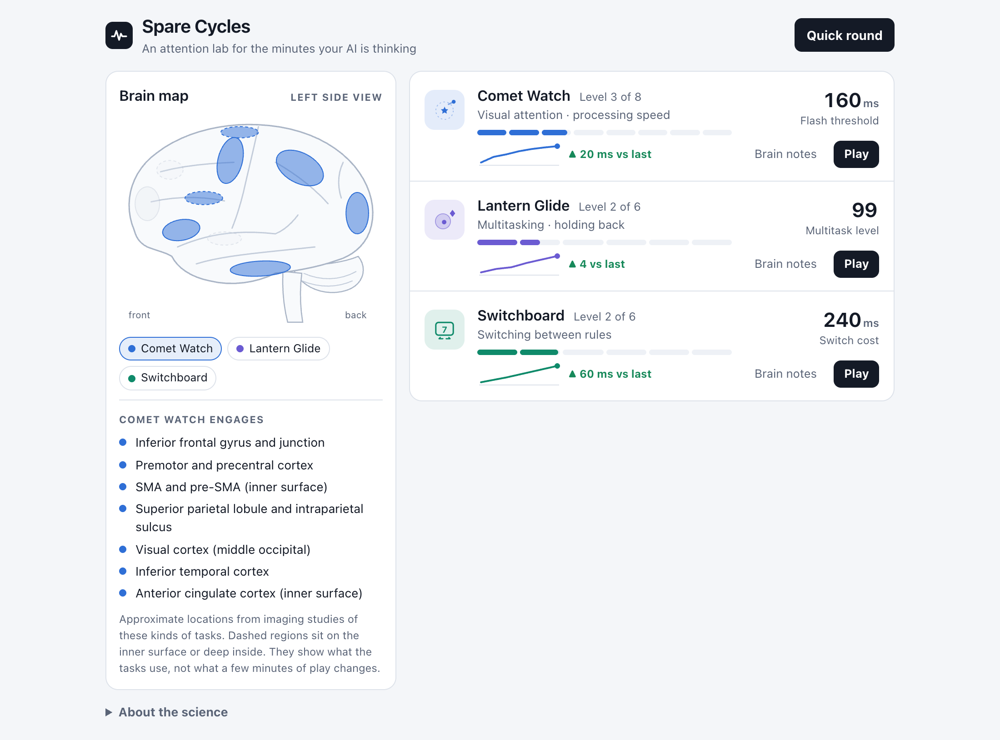
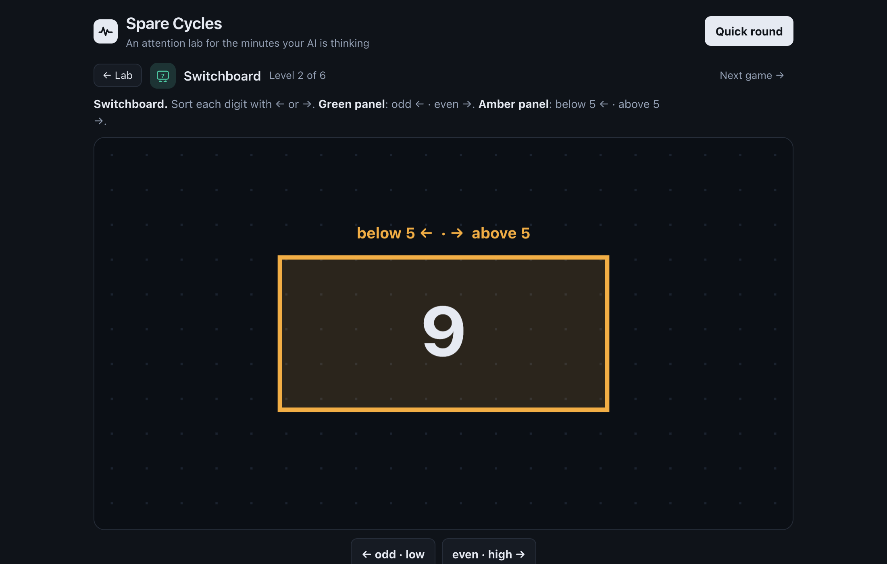
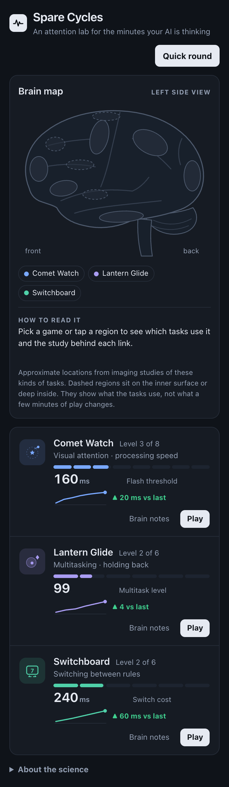

# Spare Cycles

[](https://github.com/frahman2310/spare-cycles/actions/workflows/test.yml)

Three short attention games you can play inside Claude, ChatGPT, Cursor or VS Code while the AI works. They run as an [MCP App](https://github.com/modelcontextprotocol/ext-apps): ask your assistant for "a game while I wait" and they open inline in the chat. Where the host supports it, you can pop them out or open them fullscreen.



<p>
  
  
</p>

<sub>Screenshots show example progress data.</sub>

| Game | What you do | What adapts | Research basis |
|---|---|---|---|
| **Comet Watch** | Two star glyphs flash in the centre while a comet streaks past. Click where the comet was, then say whether the glyphs were the same or different. | Flash time (500 → 17 ms), using a 2-down-1-up staircase. Levels widen the comet ring, add tail-less look-alike stars, then make "different" glyphs differ by a single point. | Useful field of view research (Ball et al. 1988), the paradigm behind the speed arm of the NIH ACTIVE trial |
| **Lantern Glide** | Keep your glider inside a drifting ring of light while catching only gold diamond sparks. | After each 30 s run, ring speed and the catch window both retune toward 80% accuracy. Stages make lures more target-like. | Pursuit tracking plus go/no-go dual-task research. The adaptive rule follows Anguera et al., *Nature* 2013 |
| **Switchboard** | Sort each digit with ← or →. A green panel means odd/even; an amber panel means below/above 5. | Answer deadline, using a 3-down-1-up staircase (~79%). Levels raise the switch rate, shorten preparation time, and add conflicting flanker digits. | Parity/magnitude task switching (Sudevan & Taylor 1987; Rogers & Monsell 1995) |

All three are original designs. They use long-published research paradigms and are not copies of any commercial product.

The interface is a **brain map lab**:
- a side-view brain map shows the regions each task engages in imaging studies (approximate, with inner and deep regions drawn dashed);
- each game card has a level track (Comet Watch 8 levels; Lantern Glide 6 lure-similarity stages; Switchboard 6 levels of switch rate, preparation time and flanker conflict) and a trend line of your score;
- "Brain notes" on each card separate what the task *engages*, what *training studies found* (with dose), and what is *not established*. Every claim links to its source.

Hosts run the game in a sandbox without browser storage, so the game saves levels and history through the MCP server to `~/.spare-cycles/progress.json` (set `SPARE_CYCLES_DATA` to change the location). The save tool is app-only, so the AI model never sees it. In a plain browser, progress is stored locally.

## Install

You need Node 20+.

```bash
git clone https://github.com/frahman2310/spare-cycles.git
```

```bash
cd spare-cycles && npm install
```

In the configs below, replace `/absolute/path/to/spare-cycles` with where you cloned it. If your MCP host can't find `node`, use the full path from `which node`.

**Claude Desktop**: add this to `claude_desktop_config.json`:
```json
{ "mcpServers": { "spare-cycles": { "command": "node", "args": ["/absolute/path/to/spare-cycles/server.js", "--stdio"] } } }
```

**Cursor** (2.6+): add the same block to `~/.cursor/mcp.json`. A Cursor forum thread reports that MCP App views stopped rendering in 3.11.19 (they worked in 3.10.11).

**VS Code**: add this to `.vscode/mcp.json`:
```json
{ "servers": { "spare-cycles": { "type": "stdio", "command": "node", "args": ["/absolute/path/to/spare-cycles/server.js", "--stdio"] } } }
```

**ChatGPT and claude.ai (web)**: these need a public HTTPS URL. Run `npm start`, which serves MCP at `http://localhost:3001/mcp`. Expose that endpoint through a tunnel or a host, then add the URL as a custom connector (ChatGPT developer mode → Apps & Connectors; Claude → Settings → Connectors).

**Anywhere else, including terminal agents like Claude Code CLI**: run `npm start` and open `http://localhost:3001/` in a browser or your editor's browser panel.

Then ask: *"open spare cycles"* or *"give me a game while you work"*.

## Develop

Run `npm start`, then open `http://localhost:3001/` to play in a browser.


- `games.html` holds the games and plays standalone. `engine.js` holds the adaptive rules. `server.js` inlines both, plus the MCP Apps bridge, into one `ui://` page.
- `npm test` checks that the staircases converge where the theory says (70.7% / 79.4%) and smoke-tests the MCP server over stdio.

## Disclaimer

This is an independent project, not affiliated with Posit Science (BrainHQ), Akili, Lumos Labs or any other brain-training company. These are short, simplified versions of research tasks, made for breaks. They are not medical devices and have not been tested as treatments. Results from studies of the original programs don't carry over to them automatically.

## License

MIT. See [LICENSE](LICENSE).
